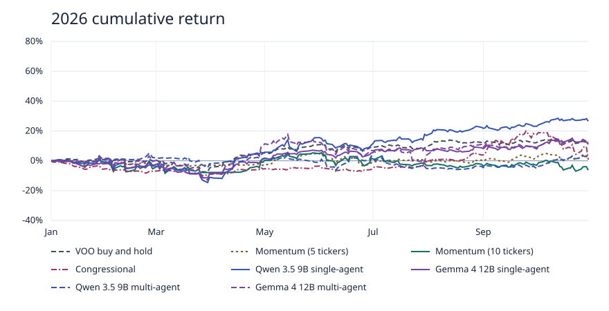
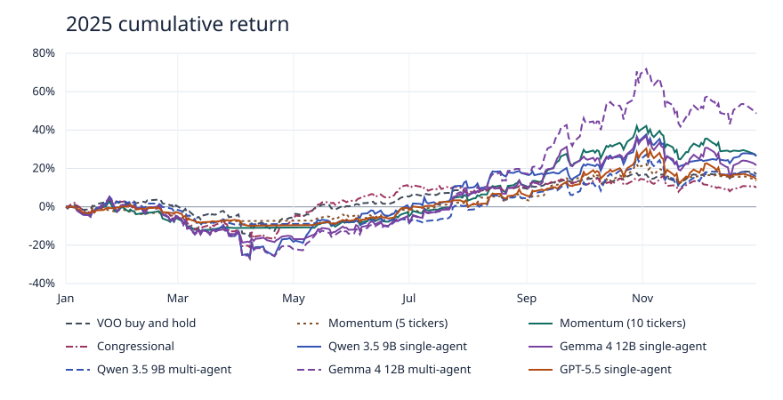

# Benchmark report — 2024–2026

## Introduction

This report compares passive VOO, moving-average momentum, a congressional disclosure strategy, and price-only LLM strategies. Each year starts with a fresh portfolio. The 2024 and 2025 results cover the full calendar year. The 2026 results run through October 30.

## Methodology

- **Trading and cash.** Each run starts with $100,000. The simulator applies 5 basis points of adverse slippage, zero commissions, and 3.5% annual interest on uninvested cash using actual days divided by 365. Dividends are credited on the ex-date and stay in cash. Weekly signals use completed bars and trade at the next eligible open. Initial allocations and eligible disclosure trades can execute at the open.

- **Portfolio limits.** VOO buy and hold targets 100% at inception. Active runs cap each position at 20% and total exposure at 100% at execution. Congressional and five-ticker momentum permit up to five holdings. The 10-ticker momentum and LLM runs permit up to ten. The smaller momentum universe is VOO, QQQ, NVDA, TSLA, and AAPL. The expanded universe adds V, DIS, BE, AMZN, and MSFT.

- **Momentum and agents.** Momentum uses weekly 20/50-session moving-average crossovers. Qwen 3.5 9B and Gemma 4 12B make weekly proposals using prices, indicators, and portfolio state. Rejected decisions generate no orders. The expanded 2024–2025 runs use `yahoo-llm-2024-2025-10-tickers-v1`; the expanded 2026 runs use `yahoo-house-2026-initial-v1`. See [LLM strategy details](llm-strategies.md).

- **Multi-agent review.** In each weekly decision, the same local model serves as technical analyst, fundamental/news analyst, risk analyst and portfolio manager. The fundamental/news analyst records missing coverage and abstains. The portfolio manager receives validated recommendations, cited evidence and disagreements. A rejected required analyst produces no orders. Roles and experiments run sequentially on one laptop. The four roles share the single-agent weekly budget of 12 model calls and eight tool requests, with up to two tool rounds per role, one retry per call and one call reserved for synthesis. All reported multi-agent runs used corrected holding units and explicit guidance on position drift. [Reproducible configurations](../configs/benchmarks/price-only-multi-agent)

- **Congressional disclosures.** The simulator assumes public availability on the filing date. Historical publication timing is unverified. It infers starting candidates from the preceding two calendar years and assigns equal weights within the five-position cap. Explicit partial sales imply a residual holding for initialization. In-period sales are modeled as full exits. See [data provenance and reproduction](real-data.md).

## Results

Charts show daily cumulative return from the $100,000 starting balance on a shared vertical scale. Max drawdown is the largest peak-to-trough equity decline. For LLMs, decisions passed counts validated portfolio decisions out of all scheduled weeks, including rejections and skips. Error counts below each chart are role-level events and include retried calls.

### 2026

| Strategy | Return | Final equity | Max drawdown | Fills | Decisions passed | Experiment ID |
|---|---:|---:|---:|---:|---:|---|
| VOO buy and hold | +11.04% | $111,038.44 | 8.89% | 1 | — | `157861d6-8a27-4459-bd03-66013269e233` |
| Momentum (5 tickers) | +1.00% | $101,004.47 | 8.66% | 145 | — | `5110fed1-a466-4e9c-8782-380d783ffb12` |
| Momentum (10 tickers) | -6.30% | $93,703.53 | 11.74% | 273 | — | `ed996021-0e92-48b6-9adf-20c4d3ae7c3f` |
| Congressional | +0.78% | $100,784.67 | 16.00% | 12 | — | `19153136-8fd8-42c2-b003-8a5110424bc7` |
| Qwen 3.5 9B single-agent | +26.52% | $126,517.54 | 15.51% | 47 | 39/43 | `27927ee9-5446-4283-9602-e1b14c85d9b7` |
| Gemma 4 12B single-agent | +11.13% | $111,130.94 | 11.46% | 50 | 39/43 | `733925e2-c399-4f1b-a646-16142d1e223d` |
| Qwen 3.5 9B multi-agent | +1.81% | $101,806.39 | 11.26% | 83 | 43/43 | `bc773ef8-10bf-4773-9520-003d4dd0bdfe` |
| Gemma 4 12B multi-agent | +12.33% | $112,325.90 | 16.67% | 29 | 43/43 | `96b55d2e-d3c8-4643-b2f2-228688d80756` |
| GPT-5.5 single-agent | -4.56% | $95,439.12 | 14.51% | 55 | 41/43 | `f23204e3-9deb-4c55-b5fe-c4f2b3dee873` |
| GPT-5.5 multi-agent | +8.17% | $108,174.06 | 18.26% | 9 | 43/43 | `9ab8aa3d-93ef-46a4-b638-80db65c0748c` |

Qwen 3.5 9B single-agent recorded portfolio `duplicate_signal_symbol` (4). Gemma 4 12B single-agent recorded portfolio `duplicate_signal_symbol` (3), portfolio `input_context_limit` (1).

### 2025

| Strategy | Return | Final equity | Max drawdown | Fills | Decisions passed | Experiment ID |
|---|---:|---:|---:|---:|---:|---|
| VOO buy and hold | +16.98% | $116,977.06 | 18.65% | 1 | — | `e513c5a6-462a-4c52-8c1c-96bc7b91fe79` |
| Momentum (5 tickers) | +13.54% | $113,538.16 | 8.59% | 176 | — | `2ea4b6a1-25f7-4f4d-a710-3a6230432a43` |
| Momentum (10 tickers) | +26.40% | $126,403.87 | 15.28% | 330 | — | `3cae4b95-078f-43a2-a4f8-9cf3007f66b8` |
| Congressional | +10.04% | $110,037.94 | 23.84% | 11 | — | `c0e20137-bd3a-4bba-a937-2fbe2315bd2e` |
| Qwen 3.5 9B single-agent | +26.56% | $126,557.21 | 29.73% | 48 | 47/52 | `cd4672d9-371f-4462-94e1-28fd1b2c97ec` |
| Gemma 4 12B single-agent | +21.65% | $121,651.11 | 22.49% | 71 | 51/52 | `6be847f1-9573-485e-baec-b2f6b66df9c5` |
| Qwen 3.5 9B multi-agent | +15.48% | $115,484.40 | 14.32% | 117 | 47/52 | `3d6ab451-726a-4949-819c-f1a12b408d82` |
| Gemma 4 12B multi-agent | +48.67% | $148,671.44 | 30.40% | 49 | 52/52 | `600ef7b8-54e1-40cd-89d4-dad78bbe7419` |
| GPT-5.5 single-agent | +14.39% | $114,391.31 | 13.53% | 60 | 48/52 | `eb269f1f-bd68-4002-8548-499108e579fe` |

Qwen 3.5 9B single-agent recorded portfolio `duplicate_signal_symbol` (5), portfolio `invalid_model_json` (2). Qwen 3.5 9B multi-agent skipped 5 scheduled weeks (no actionable candidates or holdings). Gemma 4 12B single-agent recorded portfolio `input_context_limit` (1).

### 2024

| Strategy | Return | Final equity | Max drawdown | Fills | Decisions passed | Experiment ID |
|---|---:|---:|---:|---:|---:|---|
| VOO buy and hold | +25.69% | $125,690.96 | 8.39% | 1 | — | `313ac87a-d981-43ce-b6e9-c3cbbafd8dda` |
| Momentum (5 tickers) | +44.43% | $144,428.29 | 18.41% | 201 | — | `5cbeedb1-b34c-431e-94c9-378166b1e4b4` |
| Momentum (10 tickers) | +50.46% | $150,463.78 | 16.87% | 377 | — | `560ec63b-e08f-4fdf-a9fd-916094bbfa39` |
| Congressional | +35.65% | $135,647.14 | 12.49% | 16 | — | `0335aa9a-9f15-400a-852b-176ad0d25781` |
| Qwen 3.5 9B single-agent | +57.72% | $157,720.82 | 16.45% | 79 | 47/52 | `cc6a7a6a-a940-41d7-bc5e-1ff5f03f5927` |
| Gemma 4 12B single-agent | +47.24% | $147,242.63 | 15.20% | 60 | 51/52 | `e33e68b5-ba6d-408d-a22c-015c271fae99` |
| Qwen 3.5 9B multi-agent | +29.83% | $129,825.23 | 14.90% | 101 | 48/52 | `a3fda12d-680f-40d2-9515-e702f496c296` |
| Gemma 4 12B multi-agent | +51.62% | $151,624.39 | 16.94% | 47 | 52/52 | `622043f0-cb2f-4e32-813a-0b2b1f1f89a2` |
| GPT-5.5 single-agent | +45.78% | $145,784.60 | 16.27% | 45 | 52/52 | `f9d4460c-3469-4729-8f60-e12b42443444` |

Qwen 3.5 9B single-agent recorded portfolio `duplicate_signal_symbol` (5). Qwen 3.5 9B multi-agent recorded portfolio `duplicate_signal_symbol` (4). Gemma 4 12B single-agent recorded portfolio `input_context_limit` (1).

## Discussion

Analyst review improved return in 3 of six model/year comparisons. The six multi-agent portfolios reconciled to daily equity. All 426 fills passed the cash and total-exposure checks. The results cover one run per model and window on a fixed universe. Across the six multi-agent runs, the three analyst roles accounted for 902 of 1,191 calls and 3.6 hours of inference time. The six single-agent runs used 387 calls in total.

**Possible hindsight from training.** The simulator supplied only prices available on each decision date, but the models also saw real ticker symbols and calendar dates. They could have recognized outcomes learned during training. Google reports a January 2025 pretraining cutoff for Gemma 4 12B, so its training window overlaps the 2024 backtest. We could not verify an exact cutoff for Qwen3.5 9B. These runs cannot establish whether either model used remembered outcomes or how much that influenced returns. Recording weekly decisions from frozen models before future market opens would test whether the observed advantages persist. [Gemma model card](https://huggingface.co/google/gemma-4-12B-it#training-dataset) · [Qwen model card](https://huggingface.co/Qwen/Qwen3.5-9B)

**2026 Qwen 3.5 9B.** Analyst review changed return by -24.71 percentage points and maximum drawdown by -4.25 points. Validated weeks went from 39 to 43 out of 43. Calls increased from 45 to 192, and mean time per scheduled decision went from 33.1 to 66.7 seconds.

**2026 Gemma 4 12B.** Analyst review changed return by +1.19 percentage points and maximum drawdown by +5.21 points. Validated weeks went from 39 to 43 out of 43. Calls increased from 58 to 172, and mean time per scheduled decision went from 36.9 to 63.0 seconds.

**2025 Qwen 3.5 9B.** Analyst review changed return by -11.07 percentage points and maximum drawdown by -15.41 points. Validated weeks went from 47 to 47 out of 52. Calls increased from 60 to 193, and mean time per scheduled decision went from 43.8 to 65.8 seconds.

**2025 Gemma 4 12B.** Analyst review changed return by +27.02 percentage points and maximum drawdown by +7.91 points. Validated weeks went from 51 to 52 out of 52. Calls increased from 88 to 208, and mean time per scheduled decision went from 44.0 to 65.1 seconds.

**2024 Qwen 3.5 9B.** Analyst review changed return by -27.90 percentage points and maximum drawdown by -1.56 points. Validated weeks went from 47 to 48 out of 52. Calls increased from 55 to 218, and mean time per scheduled decision went from 38.6 to 84.8 seconds.

**2024 Gemma 4 12B.** Analyst review changed return by +4.38 percentage points and maximum drawdown by +1.73 points. Validated weeks went from 51 to 52 out of 52. Calls increased from 81 to 208, and mean time per scheduled decision went from 45.4 to 73.2 seconds.

## Conclusion

Give the 2026 results the most weight when comparing models. Only that window falls entirely after both GPT-5.5’s December 1, 2025 knowledge cutoff and Gemma 4 12B’s January 2025 pretraining cutoff. Qwen3.5 9B’s model card does not specify a cutoff. [GPT-5.5 documentation](https://developers.openai.com/api/docs/models/gpt-5.5) · [Gemma model card](https://huggingface.co/google/gemma-4-12B-it#training-dataset) · [Qwen model card](https://huggingface.co/Qwen/Qwen3.5-9B)

Across all three years, multi-agent Gemma and single-agent Qwen earned higher returns than their respective counterparts, with larger maximum drawdowns in both cases. Gemma’s multi-agent return advantage ranged from 1.19 percentage points in 2026 to 27.02 in 2025. Across all six comparisons, multi-agent runs used 3.1× as many model calls.

Each comparison used one run per strategy on the same ten tickers. Repeated runs on held-out periods and other ticker universes would test whether the pattern persists.

GPT-5.5 earned a lower return than both local single agents in all three windows. In 2025 it returned 14.39%, compared with 26.56% for Qwen and 21.65% for Gemma, while recording the smallest maximum drawdown of the three (13.53%). Across all three windows, GPT-5.5 validated all 141 weekly decisions it attempted, out of 147 scheduled weeks. In 2025 it validated 48 of 48 attempts. On April 11, April 17, April 25, and May 2, the portfolio held only cash and none of the ten tickers passed the entry screen, so the simulator skipped those four calls.

In 2026, multi-agent review improved GPT-5.5’s return by 12.73 percentage points and increased maximum drawdown by 3.75 points. All 43 scheduled decisions validated. The run made 172 API calls without retries and cost an estimated $3.71 under its $10 cap, compared with $1.38 for the single-agent run. [Multi-agent configuration](../configs/benchmarks/price-only-multi-agent/2026-gpt-5.5.json)
