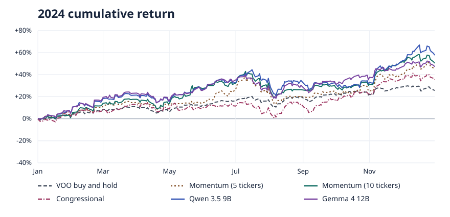

# Benchmark report — 2024–2026

## Introduction

This report compares passive VOO, moving-average momentum, a congressional disclosure strategy, and two price-only single agents. Each year starts with a fresh portfolio. The 2024 and 2025 results cover the full calendar year. The 2026 results run through October 30.

## Methodology

- **Trading and cash.** Each run starts with $100,000. The simulator applies 5 basis points of adverse slippage, zero commissions, and 3.5% annual interest on uninvested cash using actual days divided by 365. Dividends are credited on the ex-date and stay in cash. Weekly signals use completed bars and trade at the next eligible open. Initial allocations and eligible disclosure trades can execute at the open.

- **Portfolio limits.** VOO buy and hold targets 100% at inception. Active runs cap each position at 20% and total exposure at 100% at execution. Congressional and five-ticker momentum permit up to five holdings. The 10-ticker momentum and LLM runs permit up to ten. The smaller momentum universe is VOO, QQQ, NVDA, TSLA, and AAPL. The expanded universe adds V, DIS, BE, AMZN, and MSFT.

- **Momentum and agents.** Momentum uses weekly 20/50-session moving-average crossovers. Qwen 3.5 9B and Gemma 4 12B make weekly proposals using prices, indicators, and portfolio state. Rejected decisions generate no orders. The expanded 2024–2025 runs use `yahoo-llm-2024-2025-10-tickers-v1`; the expanded 2026 runs use `yahoo-house-2026-initial-v1`. See [LLM strategy details](llm-strategies.md).

- **Congressional disclosures.** The simulator assumes public availability on the filing date. Historical publication timing is unverified. It infers starting candidates from the preceding two calendar years and assigns equal weights within the five-position cap. Explicit partial sales imply a residual holding for initialization. In-period sales are modeled as full exits. See [data provenance and reproduction](real-data.md).

## Results

Charts show daily cumulative return from the $100,000 starting balance on a shared vertical scale. Max drawdown is the largest peak-to-trough equity decline. Decision counts apply to the LLM runs.

### 2026

| Strategy | Return | Final equity | Max drawdown | Fills | Decisions passed | Experiment ID |
|---|---:|---:|---:|---:|---:|---|
| VOO buy and hold | +11.04% | $111,038.44 | 8.89% | 1 | — | `157861d6-8a27-4459-bd03-66013269e233` |
| Momentum (5 tickers) | +1.00% | $101,004.47 | 8.66% | 145 | — | `5110fed1-a466-4e9c-8782-380d783ffb12` |
| Momentum (10 tickers) | -6.30% | $93,703.53 | 11.74% | 273 | — | `ed996021-0e92-48b6-9adf-20c4d3ae7c3f` |
| Congressional | +0.78% | $100,784.67 | 16.00% | 12 | — | `19153136-8fd8-42c2-b003-8a5110424bc7` |
| Qwen 3.5 9B | +26.52% | $126,517.54 | 15.51% | 47 | 39/43 | `27927ee9-5446-4283-9602-e1b14c85d9b7` |
| Gemma 4 12B | +11.13% | $111,130.94 | 11.46% | 50 | 39/43 | `733925e2-c399-4f1b-a646-16142d1e223d` |

Qwen had four duplicate-ticker rejections. Gemma had three duplicate-ticker rejections and one input context limit rejection.

### 2025

| Strategy | Return | Final equity | Max drawdown | Fills | Decisions passed | Experiment ID |
|---|---:|---:|---:|---:|---:|---|
| VOO buy and hold | +16.98% | $116,977.06 | 18.65% | 1 | — | `e513c5a6-462a-4c52-8c1c-96bc7b91fe79` |
| Momentum (5 tickers) | +13.54% | $113,538.16 | 8.59% | 176 | — | `2ea4b6a1-25f7-4f4d-a710-3a6230432a43` |
| Momentum (10 tickers) | +26.40% | $126,403.87 | 15.28% | 330 | — | `3cae4b95-078f-43a2-a4f8-9cf3007f66b8` |
| Congressional | +10.04% | $110,037.94 | 23.84% | 11 | — | `c0e20137-bd3a-4bba-a937-2fbe2315bd2e` |
| Qwen 3.5 9B | +26.56% | $126,557.21 | 29.73% | 48 | 47/52 | `cd4672d9-371f-4462-94e1-28fd1b2c97ec` |
| Gemma 4 12B | +21.65% | $121,651.11 | 22.49% | 71 | 51/52 | `6be847f1-9573-485e-baec-b2f6b66df9c5` |

Qwen had five duplicate-ticker rejections. Gemma had one input context limit rejection.

### 2024

| Strategy | Return | Final equity | Max drawdown | Fills | Decisions passed | Experiment ID |
|---|---:|---:|---:|---:|---:|---|
| VOO buy and hold | +25.69% | $125,690.96 | 8.39% | 1 | — | `313ac87a-d981-43ce-b6e9-c3cbbafd8dda` |
| Momentum (5 tickers) | +44.43% | $144,428.29 | 18.41% | 201 | — | `5cbeedb1-b34c-431e-94c9-378166b1e4b4` |
| Momentum (10 tickers) | +50.46% | $150,463.78 | 16.87% | 377 | — | `560ec63b-e08f-4fdf-a9fd-916094bbfa39` |
| Congressional | +35.65% | $135,647.14 | 12.49% | 16 | — | `0335aa9a-9f15-400a-852b-176ad0d25781` |
| Qwen 3.5 9B | +57.72% | $157,720.82 | 16.45% | 79 | 47/52 | `cc6a7a6a-a940-41d7-bc5e-1ff5f03f5927` |
| Gemma 4 12B | +47.24% | $147,242.63 | 15.20% | 60 | 51/52 | `e33e68b5-ba6d-408d-a22c-015c271fae99` |

Qwen had five duplicate-ticker rejections. Gemma had one input context limit rejection.

## Discussion

**Qwen 3.5 9B delivered the highest return in all three tested windows.** It returned 57.72% in 2024, 26.56% in 2025, and 26.52% through October 30, 2026. Its 2025 lead over 10-ticker momentum was just 0.15 percentage points using unrounded returns, while its maximum drawdown was 29.73% versus momentum’s 15.28%.

Gemma had a smaller maximum drawdown than Qwen in every window and passed eight more weekly decisions overall. Qwen is the strongest candidate here if return is the priority. The results come from one run per model per window on a fixed ticker universe, so the ranking applies to these backtests.
