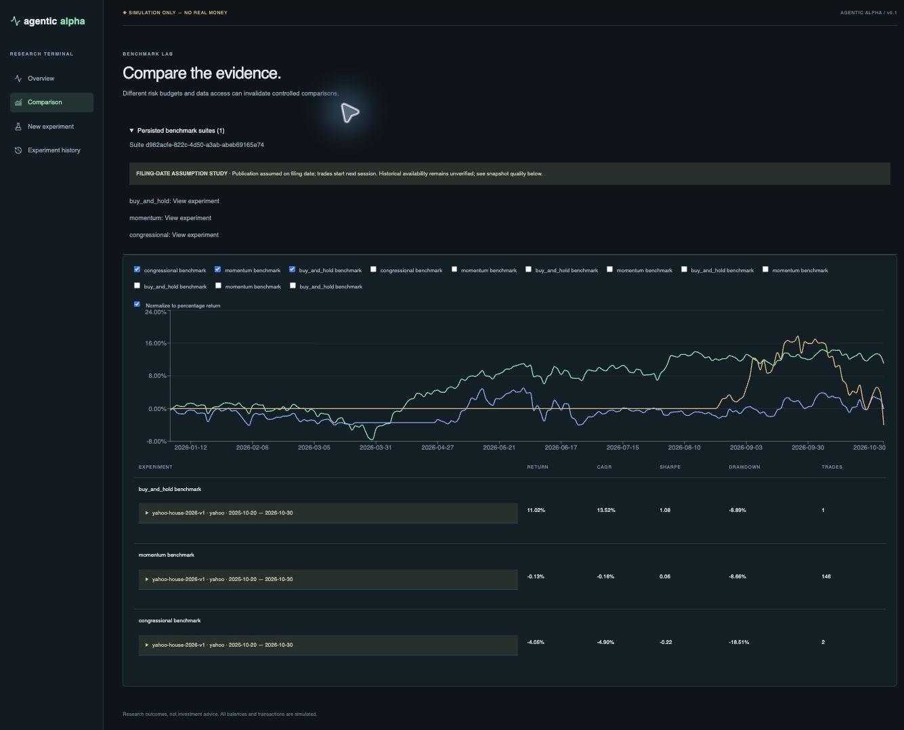
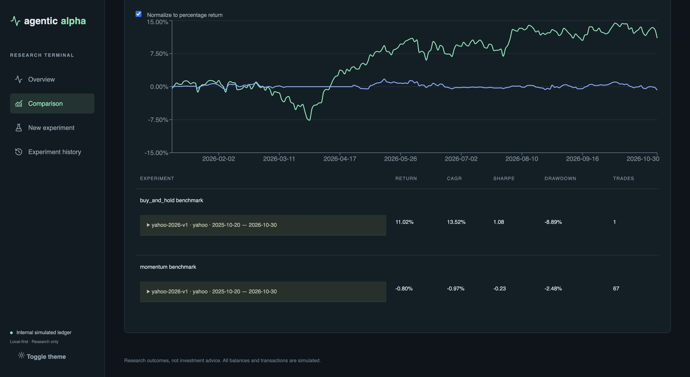

# Benchmark report — 2024–2026

## 2026 comparison: 3.5% cash interest

Annual rate 3.5%, actual calendar days/365, credited before each session on the preceding cash balance. Accrual starts January 1 and ends at the final simulated close, October 30; no post-close weekend interest is included. Credited interest compounds at session boundaries. The period is 2026-01-01 through 2026-11-01. Each strategy starts with $100,000, zero fees and 5 bps slippage. Congressional uses the inferred starting holdings described below; momentum uses 20/50-session averages and weekly rebalance. Publication is assumed on filing date and remains historically unverified.

| Strategy | Return | Final equity | Cash interest | Average exposure | Fills |
|---|---:|---:|---:|---:|---:|
| buy_and_hold | 11.0384% | $111,038.44 | $20.50 | 99.6510% | 1 |
| momentum | 1.0045% | $101,004.47 | $1,068.39 | 63.4314% | 145 |
| congressional | 0.7847% | $100,784.67 | $1,360.97 | 51.4785% | 12 |

Suite: `08a166e1-b452-45ff-82c1-07d7fa9b1524`. [Configuration](../configs/examples/pelosi-family-2026-interest.json). Full persisted report: `reports/pelosi-family-2026-interest.md`. All three runs reproduced exactly offline. Validation: 93 existing tests plus the new calendar-day interest/restart test passed.

## 2025 comparison: 3.5% cash interest

Period: **2025-01-01 through 2025-12-31**. All three strategies completed with $100,000 initial capital, zero fees, 5 bps slippage, and 3.5% annual interest on overnight cash using actual calendar days/365. Cash dividends use the ex-date approximation. VOO targets 100%; active strategies retain 20% position caps, five positions and maximum 100% exposure. Momentum retains VOO, QQQ, NVDA, TSLA, AAPL, 20/50-session averages and weekly rebalance.

| Strategy | Return | Final equity | Cash interest | Average exposure | Fills |
|---|---:|---:|---:|---:|---:|
| buy_and_hold | 16.9771% | $116,977.06 | $27.53 | 99.5244% | 1 |
| momentum | 13.5382% | $113,538.16 | $1,211.77 | 64.4713% | 176 |
| congressional | 10.0379% | $110,037.94 | $15.62 | 99.8385% | 11 |

Congressional assumes filing-date publication and infers starting holdings from 2023–2024 disclosures. The recovered candidate set is DIS, GOOGL, MSFT, NFLX, NVDA, PYPL, RBLX, V. The existing alphabetical five-position cap selects **DIS, GOOGL, MSFT, NFLX, NVDA**, initially targeting 20% each. PYPL, RBLX and V remain audited cap exclusions. Actual residual share counts are unknown; explicit partial sales imply a residual candidate, while during-study sales retain full-exit semantics.

Parser `house-ptr-layout/4` recognizes the split two-row header in document 20022260, attaches the opening page-2 status/notes to the final page-1 NFLX transaction, and recovers the complete borderless DIS tail row. Page 2 was visually inspected against the source PDF. Original bytes and both-page locators remain preserved. New immutable history snapshot `house-pelosi-pre2025-v3`: **11 PDFs, 30 rows, 15 unsupported, zero quarantines**. Publication quality remains unverified. The in-period snapshot `house-pelosi-2025-v1` retains 12 rows and zero quarantines.

Price snapshot `yahoo-house-2025-interest-v2` includes the expanded candidate union and 51 preceding warmup sessions; momentum candidates remain unchanged. Suite: `0c4b71cd-6630-4c60-9af0-385ce4d6df45`. [Configuration](../configs/examples/pelosi-family-2025-interest.json). Full report: `reports/pelosi-family-2025-interest-v2.md`. All three persisted worker results reproduce exactly offline for metrics, fills and equity points.

The earlier blocked suite `a02f0499-d393-467d-b3ee-31cda7711e2d` and original snapshots remain preserved. Its congressional block came from extraction diagnostics that are now resolved; its price-only returns were VOO +16.9771% and momentum +13.5382%.

- buy_and_hold: `e513c5a6-462a-4c52-8c1c-96bc7b91fe79`
- momentum: `2ea4b6a1-25f7-4f4d-a710-3a6230432a43`
- congressional: `c0e20137-bd3a-4bba-a937-2fbe2315bd2e`

## 2024 comparison: 3.5% cash interest

Requested period: **2024-01-01 through 2024-12-31**. Same $100,000 initial capital, zero fees, 5 bps adverse slippage and ex-date cash dividends. Overnight cash earns 3.5% annually, actual calendar days/365, credited before each session; January 1–December 31 accrual ends at the final session. VOO targets 100%; momentum uses VOO, QQQ, NVDA, TSLA, AAPL, 20/50-session averages and weekly rebalance. Active limits remain 20% per position, five positions and 100% exposure.

| Strategy | Outcome | Return | Final equity | Cash interest | Average exposure | Fills |
|---|---|---:|---:|---:|---:|---:|
| buy_and_hold | Completed | 25.6910% | $125,690.96 | $30.56 | 99.5014% | 1 |
| momentum | Completed | 44.4283% | $144,428.29 | $1,153.23 | 71.7039% | 201 |
| congressional | Completed | 35.6471% | $135,647.14 | $10.40 | 99.9802% | 16 |

The revised congressional initialization uses `house-pelosi-pre2024-v4`: 17 PDFs, 48 records, 35 unsupported entries, zero quarantines. Parser v5 recognizes older mixed-case identity/header text and normalizes explicitly printed tickers and asset codes to uppercase while retaining original extraction. Five amended rows from 20020561 were reviewed against the unique corresponding rows in 20020515 using owner, asset, date, action, amount and full description; corrections preserve explicit `amends` links and evidence. These rows are partnership units or option exercises and remain ineligible for ordinary stock trading. Publication remains unverified under the filing-date assumption.

The two-year lookback remains 2022–2023. Initial targets are the first five alphabetical residual candidates at 20% each. The in-period `house-pelosi-2024-v1` snapshot and `yahoo-house-2024-interest-v1` price snapshot remain unchanged.

Suite: `c9371013-8bf0-4a03-8027-b50bb99b132d`. [Configuration](../configs/examples/pelosi-family-2024-interest.json). Full report: `reports/pelosi-family-2024-interest-v2.md`. All three completed worker results reproduced exactly offline for metrics, fills and every equity point. The prior blocked suite `74c86ecc-4b44-469c-a853-592acd280311` remains preserved. Amendment review evidence is retained in the immutable snapshot and local `reports/pre2024-amendment-review.json`.

- buy_and_hold: `313ac87a-d981-43ce-b6e9-c3cbbafd8dda`
- momentum: `5cbeedb1-b34c-431e-94c9-378166b1e4b4`
- congressional: `0335aa9a-9f15-400a-852b-176ad0d25781`

## Starting portfolio assumption

The separate immutable `house-pelosi-pre2026-v1` snapshot contains eight official 2024–2025 PTR PDFs, 22 normalized rows, 15 unsupported entries and zero quarantines. Only disclosures available under the filing-date assumption from **2024-01-01 through 2025-12-31** enter initialization. No 2026 transaction or sale selects starting holdings.

Eligible stock/ETF purchases establish candidates. Explicit `S (partial)` sales imply an unknown residual holding, even if its purchase predates the lookback. Other eligible sales remove candidates. Conflicts block initialization; amendments cannot replay processed transactions. Options, exercises, contributions, and unsupported asset types remain excluded. Partial-sale handling applies to this inference step; sales during the 2026 simulation retain the existing full-exit approximation.

The inferred candidates are **AAPL, MSFT, NVDA, and V**, targeting **20% each**, with approximately 20% cash. Equal targets ignore unknown actual share counts and disclosure amount ranges. The first January 2 open establishes these positions through the shared risk checks and ledger, with normal slippage; there are no pre-period returns or inherited cost bases. Additional candidates would use the existing alphabetical five-position cap.

| Candidate | Pre-start evidence |
|---|---|
| AAPL | Partial sale, filed January 17, 2025; document 20026590, page 1 |
| MSFT | Partial sale, filed July 30, 2024; document 20025535, page 1 |
| NVDA | 2024 purchases and partial sale filed January 17, 2025; documents 20025368, 20025535, 20026590 |
| V | Partial sale, filed July 2, 2024; document 20025368, page 1 |

This is a bounded-lookback hypothetical portfolio, not a reconstruction of the family’s actual holdings. Unobserved older holdings, omitted options, later dispositions not represented by supported records, and historical revisions remain unknown. Current archive retrieval does not establish historical publication evidence.

## Comparison and verification

Congressional return changes from **−4.0534%** in the preserved cash-start study to **−0.5744%**, a **3.4790 percentage-point** increase. Average exposure rises from 10.4757% to 51.6544%. VOO and momentum financial results are unchanged. Different exposure budgets prevent interpreting the return difference as evidence of strategy superiority.

The new immutable price snapshot `yahoo-house-2026-initial-v1` adds MSFT and V to the original union. Momentum remains restricted to VOO, QQQ, NVDA, TSLA, AAPL. It retains 51 preceding warmup sessions. Overlapping raw OHLC and volume match the prior snapshot; 229 inspection-only adjusted-close values differ by at most 0.0001220703125 and are never used for execution.

All three results reproduce exactly offline for metrics, fills, and every equity point. **93 backend tests** and the frontend production build passed, including new cutoff, partial-sale, cap, amendment, missing-price, conflict, and checkpoint-recovery tests. No schema migration or ledger arithmetic change. Existing dependency and bundle-size warnings remain.

## Reproduction and saved evidence

Suite: `e7305757-59e8-4e67-8288-3609c2ab5cf1`. Config: [pelosi-family-2026-initial-holdings.json](../configs/examples/pelosi-family-2026-initial-holdings.json). Full local report: `reports/pelosi-family-2026-initial-holdings-v1.md`. Offline verification: `reports/pelosi-family-2026-initial-verification.json`. Both snapshots and source artifacts remain immutable and outside Git. Execution provenance records input hashes and the implementation hash at execution.

- buy_and_hold: `65797fbc-61b8-483c-a57b-92edea180268`
- momentum: `40cb76d0-df45-4558-987c-78f70b9665fd`
- congressional: `df91104c-178b-4cef-80f3-a9e9eced161b`

[Open the updated local comparison](http://127.0.0.1:5173/compare?suite=e7305757-59e8-4e67-8288-3609c2ab5cf1&experiment=65797fbc-61b8-483c-a57b-92edea180268&experiment=40cb76d0-df45-4558-987c-78f70b9665fd&experiment=df91104c-178b-4cef-80f3-a9e9eced161b). The [historical screenshots below](#historical-screenshots) do not show this run.

The benchmark was executed before implementation commit `e6ed9b9`; its implementation hash identifies the execution code. For this 2026 run, 2024–2025 disclosures are initialization evidence; the separate 2025 comparison appears above.

## Source provenance and parser validation

The [House portal report view](https://disclosures-clerk.house.gov/FinancialDisclosure/ViewReport) links annual `YYYYFD.zip` archives. The acquired 2026 archive contains `2026FD.xml` and a tab-separated companion file. XML rows contain First, Last, StateDst, Year, FilingType, FilingDate and DocID. Exact Nancy/Pelosi names plus a California district are mapped to [the Clerk's P000197 profile](https://clerk.house.gov/members/P000197); broad surname matches are not used. Current `P` index rows were checked against the downloaded PTR titles and document IDs. Other report types remain in the discovery audit but are not parsed as PTRs.

The [official instructions](https://ethics.house.gov/wp-content/uploads/2023/12/FINAL-2021-FD-Instructions_1.pdf) describe optional SP/DC/JT owner labels. Blank ownership is unknown, not self. The [House asset-code reference](https://fd.house.gov/reference/asset-type-codes.aspx) distinguishes ST stocks, EF ETFs, OP options, PS private stock and CS bonds/notes; CS is not treated as common stock. The [source access notice](https://disclosures-clerk.house.gov/FinancialDisclosure/ViewSearch) restricts commercial use, credit-rating use, solicitation and unlawful uses. Source availability is not a redistribution license. Original PDFs/indexes/real exports remain ignored local artifacts.

FilingDate in the index, notification dates, and digital signature dates are retained separately from retrieval and ingestion. None of these inspected fields establishes historical public posting time. HTTP Last-Modified and PDF metadata are not used as evidence. Discovery and historical revisions remain **unknown**, parsing is complete for the supplied documents in the current snapshots, and historical availability is **unverified**. Index acquisition has no pagination: the complete bounded XML archive is read; this is only completeness relative to that current archive, not proof of historical disclosure coverage.

Parser `house-ptr-layout/3` resolves the three prior diagnostics in document 20033725:

- TEM begins below the detected table on page 2 and continues in the first body row on page 3. Matching column geometry and complementary owner/action/date/amount fields permit a deterministic adjacent-page join. Both source fragments and their bounding boxes are retained. The exercise note makes this an unsupported option exercise, not an ordinary purchase.
- VSNT on page 3 reports an exact `$15.00`. Exact dollar values now retain equal lower/upper bounds and an explicit amount kind. The exchange action remains unsupported.

Rendered original pages were checked against both entries. Conflicting, orphaned, or ambiguous continuations and malformed amounts still quarantine. No OCR, LLM extraction, inferred ticker, or source-date certification was introduced.

The new immutable `house-pelosi-2026-v3` snapshot reparses the same five preserved official PDFs: **29 normalized rows, 21 unsupported, zero quarantines**. All 29 remain unverified for historical availability. Parsing is complete for supplied documents; historical discovery and revisions remain uncertain. Older snapshots and the blocked suite in run history remain intact. Manifest hash: `905f69550011a2b419ff1ba958bb6054e45e8209d3e01a6c95e2c0a7ea6dd59d`.

The five 2026 PDFs are 20033725, 20034836, 20035143, 20035553 and 20035780. The last was filed November 6 and remains audit-only for the requested period. Eight 2026 entries qualify under the filing-date assumption: five sales (AMZN, NVDA, PYPL, AAPL, DIS) and three purchases (BE twice, INTC once). The starting-holdings inference uses a separate pre-2026 snapshot; it does not use these sales to select initial positions.

Representative review also confirmed the GOOGL exercise note, the AMZN note continuation across pages 1–2, and the unsupported WBD merger transaction. Original text, PDF hashes, source identities, page/row/bounding-box locators and diagnostics remain in immutable artifacts. Blank owners remain unknown. Embedded small-cap fonts can yield NUL characters in labels; normalization uses text cells and geometry, with no OCR or inferred ticker mapping. Scans, unresolved identities, ambiguous amendments and unsupported layouts require review. Synthetic amendment tests do not establish real amendment links.

Current price content hash: `4e499948ca55fb741c23b38819b99d47a477ff4c69d624fc98b826d0d9ea3d27`. Pre-start snapshot hash: `c83c66a28e190f268b73b9570161e5fa421b645195c42086eca73fd54daf7552`. Execution implementation hash: `9960719619e71f4816279395efe75f432097dec4cad1c16669783a59f967a98b`.

The price universe is VOO, QQQ, NVDA, TSLA, AAPL, AMZN, BE, DIS, INTC, PYPL, MSFT, V. Momentum's universe does not expand with it. Yahoo data are obtained through the pinned unofficial adapter; provider terms, fixed-universe selection bias, survivorship, delisting coverage and historical revisions remain limitations. No synthetic disclosure stands in for a real record. No brokerage or real-money execution exists.

## Validation scope

The current 93-test backend suite, frontend production build and exact offline replay are described above. Earlier parser-stage validation also passed Docker/PostgreSQL migration, synthetic PDF/index ingestion, evidence correction, three-strategy worker execution, persisted reporting, artifact integrity and unchanged results after API/worker restart. That Docker run preceded the inferred-starting-holdings change; it is not presented as a fresh Docker test of the current implementation. New initialization recovery is covered by deterministic backend regression tests.

The earlier independent Decimal reconciliation of VOO's first-open entry, 5 bps slippage, dividends and final close matched final equity of $111,016.89122586726. All testing and execution are simulated. Existing Python deprecation and Vite bundle-size warnings remain.

## Run history

These are preserved experiments, not competing current result tables. The current run is the first row. All listed 2026 runs use January 1–November 1; VOO and momentum return +11.0169% and −0.1290% respectively.

| Run | Congressional outcome | Saved suite | Local report |
|---|---|---|---|
| Inferred pre-start holdings; filing-date assumption | Completed, −0.5744%, 12 fills | `e7305757-59e8-4e67-8288-3609c2ab5cf1` | `reports/pelosi-family-2026-initial-holdings-v1.md` |
| Cash start; parser v3; filing-date assumption | Completed, −4.0534%, 2 fills | `d982acfe-822c-4d50-a3ab-abeb69165e74` | `reports/pelosi-family-2026-filing-date-v3.md` |
| Cash start; parser v2; verified publication required | Blocked: unverified timing and unresolved fragments | `6cd05d38-4398-4600-a4b0-dfac39d66f4c` | `reports/pelosi-family-2026-v2.md` |
| Earlier five-symbol price-only baseline | Not requested | `15c581b6-626e-4bd8-b95b-d79e76baa2bb` | `reports/2026-expanded-benchmark.md` |

The cash-start run used [this configuration](../configs/examples/pelosi-family-2026-filing-date.json), `yahoo-house-2026-v1`, and `house-pelosi-2026-v3`. Its five sales found no holdings; BE and INTC purchases executed at the August 24 open after the August 21 filing date. It ended at $95,946.56, with 10.4757% average exposure and −18.5098% maximum drawdown. All metrics, fills and equity points reproduced offline. Its configuration hash is `9c473c3998028346d6f031542e44c68213b34283889054d83a6e6fb4105a1bc8`.

The blocked run used [the default verified-timing configuration](../configs/examples/pelosi-family-2026.json) and snapshot v2: 27 rows, 19 unsupported and three quarantine diagnostics relating to two transactions. Those are historical parser counts, not the current zero-quarantine state. The original snapshots remain untouched. Resolving PDF fragments did not verify publication timing; default verified timing still blocks the unverified source records.

Historical experiment IDs:

| Run | VOO | Momentum | Congressional |
|---|---|---|---|
| Cash-start v3 | `ded2e0d8-b101-46bb-bba4-b4fd1891f187` | `2f2775ad-abab-4813-9eab-4f9aeaf3b195` | `bccabdf3-6073-459c-9676-c9bd8ff6d35f` |
| Blocked v2 | `2f2050b6-8382-44df-8046-9968a11bf05b` | `0cdb5e09-9e99-46d8-b546-6ac399c38273` | Blocked suite member; no completed experiment |
| Earlier five-symbol baseline | `70848ba6-b82b-4902-891d-cfb89e227753` | `fb9611d1-5908-497a-9532-028ce7036e54` | Not requested |

Earlier verification milestones were 53 backend tests for the price-only baseline, 75 for initial House ingestion, and 88 for parser v3 plus the filing-date study. These are historical counts, superseded by the current 93-test validation. Earlier Quiver tests used mocks; no real Quiver acquisition or performance claim underpins this report.

## Historical screenshots

No screenshot of the inferred-starting-holdings run has been captured. Use the current comparison link above for its chart.

Prior cash-start study: −4.0534% congressional return

Native Chrome inspection confirmed all three completed results and the filing-date notice. Green is VOO, blue momentum, gold congressional. This image is historical and does not show the current starting portfolio.

Earlier two-symbol comparison, superseded before the five-symbol baseline

This historical image shows VOO/NVDA with a 10% active cap. It does not depict the current five-symbol momentum setup or any congressional result.

