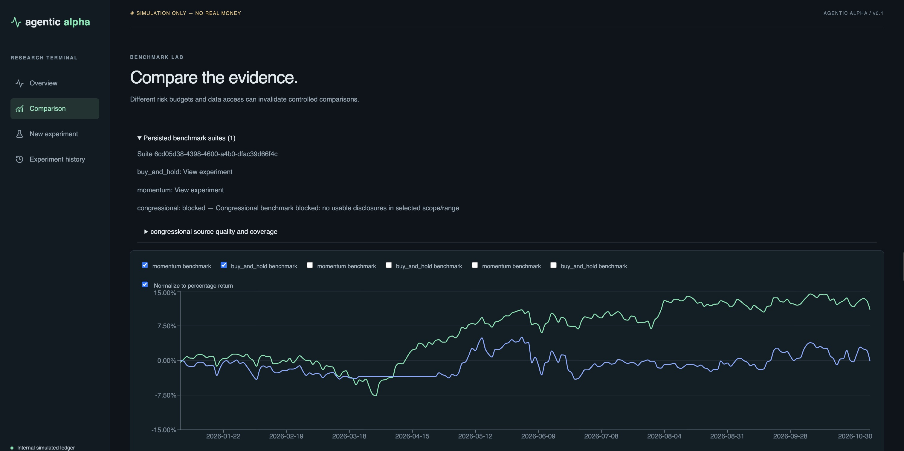

# House PDF and Pelosi-family validation — November 14, 2026

**SIMULATION ONLY — NO REAL MONEY.** The requested January 1–November 1, 2026 suite was persisted: VOO and momentum completed; congressional is blocked. No synthetic disclosure substituted for missing historical evidence.

## Official-source observations

The [House portal report view](https://disclosures-clerk.house.gov/FinancialDisclosure/ViewReport) links annual `YYYYFD.zip` archives. The acquired 2026 archive contains `2026FD.xml` and a tab-separated companion file. XML rows contain First, Last, StateDst, Year, FilingType, FilingDate and DocID. Exact Nancy/Pelosi names plus a California district are mapped to [the Clerk's P000197 profile](https://clerk.house.gov/members/P000197); broad surname matches are not used. Current `P` index rows were checked against the downloaded PTR titles and document IDs. Other report types remain in the discovery audit but are not parsed as PTRs.

The [official instructions](https://ethics.house.gov/wp-content/uploads/2023/12/FINAL-2021-FD-Instructions_1.pdf) describe optional SP/DC/JT owner labels. Blank ownership is unknown, not self. The [House asset-code reference](https://fd.house.gov/reference/asset-type-codes.aspx) distinguishes ST stocks, EF ETFs, OP options, PS private stock and CS bonds/notes; CS is not treated as common stock. The [source access notice](https://disclosures-clerk.house.gov/FinancialDisclosure/ViewSearch) restricts commercial use, credit-rating use, solicitation and unlawful uses. Source availability is not a redistribution license. Original PDFs/indexes/real exports remain ignored local artifacts.

FilingDate in the index, notification dates, and digital signature dates are retained separately from retrieval and ingestion. None of these inspected fields establishes historical public posting time. HTTP Last-Modified and PDF metadata are not used as evidence. Discovery and historical revisions remain **unknown**, parsing is **partial**, and historical availability is **unverified**. Index acquisition has no pagination: the complete bounded XML archive is read; this is only completeness relative to that current archive, not proof of historical disclosure coverage.

`house-pelosi-2026-v2` preserves five PDFs: 20033725, 20034836, 20035143, 20035553 and 20035780. All five current indexed PTRs downloaded successfully; the last is filed November 6 and is retained for audit, not backdated into the requested period. Parser `house-ptr-layout/2`, pdfplumber 0.11.9, produced **27 normalized rows, all 27 unverified, 19 unsupported by asset/action, and three quarantine diagnostics**. Two diagnostics identify unresolved transaction rows; one identifies a page with an unrecognized transaction fragment, so three diagnostics must not be misrepresented as three independent transactions. Eight normalized rows have otherwise eligible stock actions, but **zero verified eligible events, zero copied records and zero congressional fills** exist. No automatic amendment links were established. First-pass snapshot `house-pelosi-2026-v1` is preserved, not overwritten.

Representative review against original text and rendered page:

| Source locator | Observation | Treatment |
|---|---|---|
| 20033725, page 1, GOOGL purchase | Stock row plus separate note says exercised calls | Unsupported; never copied as an ordinary stock purchase |
| 20033725, pages 1–2, AMZN partial sale | Status and sale note continue across a repeated header | Main-row identity retained; continuation page/bounds preserved; unverified availability |
| 20033725, page 3, TEM fragment | Missing main fields in extracted table; page 2 contains text outside recognized table | Quarantined for manual review; no inferred purchase |
| 20033725, page 3, VSNT exchange | Non-range amount `$15.00` | Quarantined instead of inventing amount bounds |
| 20035780, page 1, WBD | SP owner, stock code, sale code, merger-cash note | Unsupported merger transaction; filing date November 6 is not publication evidence |

The sample page rendered correctly. Embedded small-cap fonts yield NUL characters in some extracted labels; original text is retained, and normalization relies on ordinary-text cells and geometrical columns. No OCR or LLM extraction was used. Amendment matching, historical revision completeness, general handwritten layouts, and fragmented transaction continuations remain review limitations. Synthetic tests exercise amendment correction with explicit evidence and prospective no-replay behavior; this is not a real amendment verification claim.

## New persisted benchmark

Suite: `6cd05d38-4398-4600-a4b0-dfac39d66f4c`. Dataset: `yahoo-house-2026-v1`. Snapshot: `house-pelosi-2026-v2`. Dataset content hash: `d675cc78d82cc3a73318421233798bb22fda9e0113e4ec0e53d92e58e282b948`. Snapshot manifest hash: `9dce45855c65b3017d9605509e58cd595c8a944539074b6b4adbf58709ee475f`. Configuration: [pelosi-family-2026.json](../configs/examples/pelosi-family-2026.json). Report: ignored `reports/pelosi-family-2026-v2.md`, generated from persisted results.

Inclusive requested range: **2026-01-01 through 2026-11-01**. Completed exchange sessions: **2026-01-02 through 2026-10-30**. Warmup: **51 preceding sessions from 2025-10-20**. The acquired price union is VOO, QQQ, NVDA, TSLA, AAPL, AMZN, BE, DIS, INTC, PYPL. All ten have complete requested/warmup price coverage. This union covers otherwise eligible parsed stock actions, not unidentified quarantined assets. Momentum's configured universe remains only the specified five baseline candidates.

| Strategy | Outcome | Return | Average exposure | Maximum drawdown | Sharpe | Fills | Adverse slippage cost |
|---|---|---:|---:|---:|---:|---:|---:|
| VOO | Completed | 11.0169% | 99.6538% | −8.8945% | 1.0841 | 1 | 49.9750 |
| Momentum | Completed | −0.1290% | 63.4590% | −8.6616% | 0.0619 | 146 | 265.7248 |
| Pelosi-family disclosure-following | Blocked | Unavailable | Unavailable | Unavailable | Unavailable | 0 | Unavailable |

Each requested leg has 100,000 starting capital, zero fees, 5 bps adverse slippage and cash dividends under the existing ex-date approximation. Passive VOO targets 100%. Active caps are 20% per position, five positions, 100% total; unused capital stays cash. Momentum uses 20/50-session averages and weekly rebalance. Congressional requests all five owner categories and event-driven capped equal targets. More than five candidates use alphabetical selection with excluded candidates audited. Source partial sales use the documented full-exit approximation. This does not measure the Pelosi family's actual holdings or return.

The suite used the normal local SQLite queue and one `app.worker` process, with a bounded 30-second CLI wait. The pre-existing Docker stack uses a separate database and was not changed. Completed VOO and momentum metrics, fills and every equity point were reproduced exactly offline from frozen inputs. Independent Decimal reconciliation of first-open VOO entry, 5 bps slippage, subsequent cash dividends and final close yielded **111,016.89122586726**, matching the ledger. Momentum's matched VOO excess return is −11.1459 percentage points. Different exposure budgets and fixed-universe selection bias prevent superiority/statistical-significance claims.

VOO experiment: `2f2050b6-8382-44df-8046-9968a11bf05b`. Momentum: `0cdb5e09-9e99-46d8-b546-6ac399c38273`. Congressional is an explicit blocked suite member with saved configuration and snapshot provenance, rather than an invented completed experiment. Input/configuration hashes, code revision and execution implementation hashes are retained in the report. The suite was run from the implementation worktree based on prompt commit `47fecd8`; implementation hashes identify the execution code independently of that base commit.

## Verification and comparison

75 backend tests and the production frontend build passed. The synthetic Docker/PostgreSQL smoke passed migration from 001 to 002, API queueing, synthetic PDF/index ingestion, evidence correction, all three strategies through the normal worker, saved report, artifact integrity and exact offline metrics/fills after API/worker restart. Automated checks use synthetic data only. No database migration or financial ledger algorithm changed; snapshot schema v2 is additive and v1 remains readable. Existing Python deprecation and Vite chunk-size warnings remain.

Comparison route (use the local research dashboard at port 5173, API proxy port 8010):

`/compare?suite=6cd05d38-4398-4600-a4b0-dfac39d66f4c&experiment=2f2050b6-8382-44df-8046-9968a11bf05b&experiment=0cdb5e09-9e99-46d8-b546-6ac399c38273`

Native Chrome inspection verified both completed results, the current dataset labels, and the blocked congressional member with source-quality details. A new screenshot was captured successfully; browser chrome was excluded. Green is VOO and blue is momentum; no congressional return curve is fabricated. The older screenshot in the [historical validation record](real-data-validation.md) remains explicitly historical.

