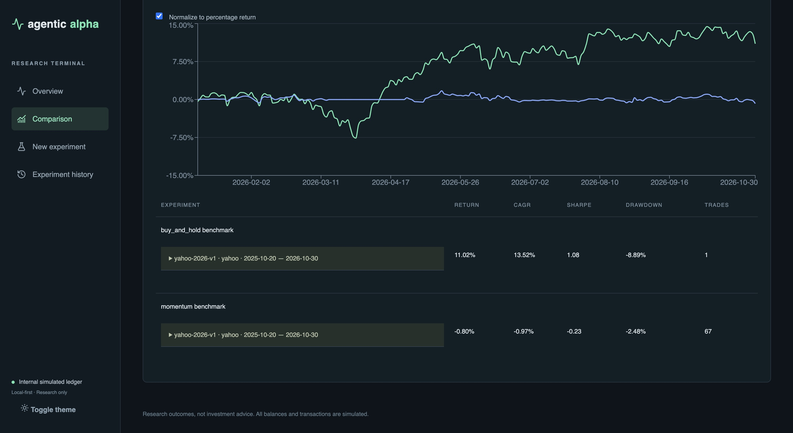

# Validation record — November 13, 2026

All results are simulations. No provider data or credentials are checked into Git.

- Backend: 53 deterministic tests passed, covering acquisition normalization, identity and evidence validation, timing, split FIFO/accounting restart, dividend entitlement and independent reinvestment reconciliation, migration from the original schema, three-strategy persistence, blocked legs, and offline repeatability.
- Frontend: production TypeScript/Vite build passed. Vite reports its existing large-chunk advisory; dependency deprecation warnings remain in Python tests.
- Browser: verified the 2026 comparison chart, dataset labels, and metrics in native Chrome; screenshot below. Comparison URLs now support repeated `experiment` parameters for reproducible selections.
- Quiver: no `QUIVER_API_KEY` in the process. Auth/pagination/schema behavior was tested with HTTP mocks, and normalized imports exercised all three strategies with synthetic fixtures. No real Quiver end-to-end or real congressional performance claim is made.
- PostgreSQL/Docker were not run; additive Alembic migration compatibility was exercised against an old-schema SQLite database. Existing legacy dataset metadata was preserved.

## 2026 benchmark: January 1 through November 1

Requested range: **2026-01-01 through 2026-11-01 inclusive**. Actual exchange sessions: January 2 through October 30 (holiday/weekend boundaries). Dataset `yahoo-2026-v1` contains VOO and NVDA, with 51 preceding warmup sessions starting October 20, 2025. Normalized content hash: `ae55415a56d202bca75b17549dbff7448551c9930f186a553f07de79443b5980`.

```sh
uv run python -m app.cli download --id yahoo-2026-v1 --symbols VOO,NVDA \
  --start 2026-01-01 --end 2026-11-01 --long-window 50
uv run python -m app.cli benchmark --dataset yahoo-2026-v1 --universe VOO,NVDA \
  --start 2026-01-01 --end 2026-11-01 \
  --strategies buy_and_hold,momentum,congressional --wait 30 \
  --output ../reports/2026-benchmark.md
```

Suite `98e5bcd5-f440-4157-9b44-a6b47639ac4c` was processed through the existing worker:

| Strategy | Status | Total return | Average exposure | Fills |
|---|---|---:|---:|---:|
| VOO buy-and-hold | Completed | 11.0169% | 99.6538% | 1 |
| Momentum | Completed | -0.8019% | 14.7851% | 67 |
| Congressional | Blocked: no verified disclosure snapshot | Unavailable | Unavailable | Unavailable |

Congressional benchmark execution is **deferred to a later PR**. The persisted three-strategy request remains incomplete, while both price-only baselines completed. No Quiver key or registered disclosure snapshots were available. No synthetic disclosures were substituted. A credential alone is insufficient without verified publication evidence and stable transaction identities; an authorized normalized local export can supply these.

Experiment IDs: VOO `3cd6c742-d095-4a6b-948f-d00e0b0ca789`; momentum `2d05c263-b34c-4110-85a5-9e353859ba01`. Initial capital 100,000; zero fees; adverse slippage 5 bps; cash dividends using the ex-date approximation; 20/50 momentum windows; weekly rebalance; 10% active position cap versus 100% passive VOO. Different exposure budgets and a selected fixed universe prevent interpreting this as a controlled claim of superiority.

The full persisted report is in ignored `reports/2026-benchmark.md`. Earlier 2024 validation suites remain in the local database but are superseded by this date-range run. The earlier 2024 offline-repeat check is historical validation, not a claim that the 2026 suite was rerun.

Acquisition exposed a calendar-boundary bug when the warmup search began on a weekend. The calendar initialization now includes an extra ten-day buffer before that search boundary.

## Comparison screenshot

The comparison link selects the two completed experiments; the blocked congressional leg has no performance curve:

`/compare?experiment=3cd6c742-d095-4a6b-948f-d00e0b0ca789&experiment=2d05c263-b34c-4110-85a5-9e353859ba01`



Green: VOO; blue: momentum. Congressional is blocked and therefore has no plotted return. Dataset labels include warmup coverage; portfolio returns start in January 2026.
